# CloudDevOpsProject

End-to-end DevOps project built as the final project of the NTI / iVolve DevOps training.
A microservices web application (registration, login and a DevOps roadmap page) is containerized with Docker, provisioned on AWS with Terraform, configured with Ansible, built by Jenkins and deployed to Kubernetes (EKS) with ArgoCD.

## Project status

- [x] 1. GitHub repository
- [x] 2. Containerization with Docker Compose
- [x] 3. Infrastructure provisioning with Terraform
- [ ] 4. Configuration management with Ansible
- [x] 5. Container orchestration with Kubernetes
- [ ] 6. Continuous integration with Jenkins
- [ ] 7. Continuous deployment with ArgoCD
- [ ] 8. Documentation (this README is updated after every part)

## Architecture overview

### Application architecture

```text
Browser
   |
   v
Frontend (Node.js, :3000)
   |-----------------------> Auth Service (Python/Flask, :5000) ---> MySQL (:3306)
   |
   '-----------------------> Roadmap Service (Java, :8080)
```

The frontend is the only entry point. Only the Auth Service talks to the database.

| Service | Technology | Port | Responsibility |
|---|---|---|---|
| frontend | Node.js 22, Express, EJS | 3000 | Web UI, user session, calls the backend services |
| auth-service | Python 3.12, Flask, gunicorn, bcrypt | 5000 | Signup and login, stores users in MySQL |
| roadmap-service | Java 21, Maven, Spring Boot | 8080 | Serves the DevOps roadmap data |
| mysql | MySQL 8.4 | 3306 | `users` table (created automatically by the auth service) |

> **Note:** the upstream application README lists the Auth Service as Java and the Roadmap Service as Python.
> The source code shows the opposite, so this documentation follows the code.

### AWS infrastructure (Terraform)

```text
                               Internet
                                  |
                          Internet Gateway
                                  |
  VPC 10.0.0.0/16 ------------------------------------------------------
  |   AZ eu-north-1a                       AZ eu-north-1b              |
  |                                                                    |
  |   Public subnet 10.0.1.0/24            Public subnet 10.0.2.0/24   |
  |     - NAT Gateway                        - (load balancers)        |
  |     - Jenkins EC2 (Ubuntu 24.04)                                   |
  |                                                                    |
  |   Private subnet 10.0.11.0/24          Private subnet 10.0.12.0/24 |
  |     - EKS worker node                    - EKS worker node         |
  ----------------------------------------------------------------------
        EKS control plane (managed by AWS)      ECR (3 repositories)
```

### CI/CD flow (target, parts 4, 6 and 7)

```text
Developer --> GitHub --> Jenkins (EC2, configured by Ansible)
                           |  Build Image -> Scan Image (Trivy) -> Push Image (ECR)
                           |  -> Delete Image Locally -> Update Manifests -> Push Manifests
                           v
                        GitHub (k8s manifests) <--- ArgoCD (in EKS) syncs to the `ivolve` namespace
```

### Endpoints used by the frontend

| Service | Method | Path |
|---|---|---|
| auth-service | POST | `/api/auth/signup` |
| auth-service | POST | `/api/auth/login` |
| auth-service | GET | `/health` |
| roadmap-service | GET | `/api/roadmap` |

### Environment variables

| Service | Variable | Description |
|---|---|---|
| auth-service | `DB_HOST`, `DB_PORT`, `DB_NAME`, `DB_USER`, `DB_PASSWORD` | MySQL connection (all required except `DB_PORT`, default 3306) |
| frontend | `AUTH_SERVICE_URL` | URL of the Auth Service |
| frontend | `ROADMAP_SERVICE_URL` | URL of the Roadmap Service |
| frontend | `SESSION_SECRET` | Secret used to sign the session cookie |

## Setup instructions

| Goal | Where |
|---|---|
| Run the application on one machine | [Part 2: Docker Compose](#part-2-containerization-with-docker-compose) |
| Create the AWS infrastructure (VPC, Jenkins server, EKS, ECR) | [Part 3: Terraform](#part-3-infrastructure-provisioning-with-terraform) |
| Deploy the application to Kubernetes | [Part 5: Kubernetes](#part-5-container-orchestration-with-kubernetes) |

Tools used: Docker and Docker Compose, Terraform 1.10 or newer, AWS CLI v2, kubectl, Helm, Git (developed on Ubuntu 24.04 under WSL).

## Repository structure

```text
.
├── auth-service/          # Flask app + Dockerfile
├── frontend/              # Express app + Dockerfile
├── roadmap-service/       # Java app + Dockerfile
├── k8s/
│   ├── base/              # namespace, config, database, services, ingress
│   ├── ingress/           # Traefik Helm values
│   └── storage/           # StorageClass for the local cluster
├── terraform/
│   ├── backend.tf         # S3 backend + AWS provider
│   ├── main.tf            # calls the modules
│   ├── variables.tf
│   ├── outputs.tf
│   └── modules/
│       ├── network/       # VPC, subnets, IGW, NAT, route tables, NACLs
│       ├── jenkins_server/# EC2 + security group + key pair
│       ├── eks/           # EKS cluster, node group, EBS CSI driver
│       └── ecr/           # container registries
├── docs/screenshots/      # Screenshots used in this README
├── docker-compose.yml
├── .env.example
└── README.md
```

## Part 2: Containerization with Docker Compose

### Run locally

```bash
git clone https://github.com/mohamedsala7320-sudo/CloudDevOpsProject.git
cd CloudDevOpsProject
cp .env.example .env      # then set your own values in .env
docker compose up --build -d
docker compose ps
```

Open http://localhost:3000, create an account and log in.

The `.env` file is ignored by Git. Only `.env.example` is committed.

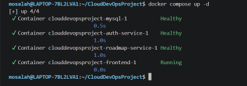


### Verify the data in MySQL

Passwords are stored as bcrypt hashes, never as plain text.

```bash
docker compose exec mysql sh -c 'mysql -uroot -p"$MYSQL_ROOT_PASSWORD" "$MYSQL_DATABASE" -e "SELECT id, username, password_hash FROM users;"'
```


### Data persistence

User data lives in the `mysql-data` volume and survives `docker compose down`.


### Design decisions

| Decision | Reason |
|---|---|
| gunicorn instead of the Flask development server | The development server is not meant for production |
| Non-root user in every image | Limits the impact of a container compromise |
| Multi-stage build for the Java service | The final image has only a JRE and the jar, so it is smaller and has fewer vulnerabilities |
| `.dockerignore` for each service | Faster builds and no local files copied into images |
| Two networks (`app-net`, `db-net`) | The frontend cannot reach the database directly |
| Healthchecks with `depends_on: service_healthy` | Services start in the right order |
| Secrets in `.env` with `:?` checks | Compose stops early with a clear message if a variable is missing |

## Part 3: Infrastructure provisioning with Terraform

All AWS resources are created with Terraform in `eu-north-1` (Stockholm), split into four modules and stored in a remote S3 state.

| Module | Path | What it creates |
|---|---|---|
| Network | `terraform/modules/network` | VPC, 2 public and 2 private subnets in 2 AZs, Internet Gateway, NAT Gateway, route tables, Network ACLs |
| Server | `terraform/modules/jenkins_server` | EC2 instance for Jenkins, security group, SSH key pair |
| EKS | `terraform/modules/eks` | EKS cluster, managed node group (2 nodes), IAM roles, EBS CSI driver |
| ECR | `terraform/modules/ecr` | 3 private repositories (one per microservice) |

### Prerequisites

- An AWS account and an IAM user used only by Terraform and the CLI.
- AWS CLI v2, Terraform 1.10 or newer (tested with 1.17), and an SSH key pair.

### 1. AWS preparation

- IAM user `terraform-admin` with the `AdministratorAccess` policy and a CLI access key (no console access, so no password). The access key is stored only in `~/.aws/credentials` and is never committed.
- AWS CLI configured for `eu-north-1`.
- A zero-spend budget with an email alert.

```bash
aws configure                      # region: eu-north-1, output: json
aws sts get-caller-identity        # must show user/terraform-admin
```


### 2. Remote state in S3

The bucket cannot be created by the same code that uses it, so it is created once with the CLI. It has versioning (to roll back a bad state), default encryption and all public access blocked.

```bash
ACCOUNT_ID=$(aws sts get-caller-identity --query Account --output text)
BUCKET=clouddevops-tfstate-$ACCOUNT_ID

aws s3api create-bucket --bucket $BUCKET --region eu-north-1 \
  --create-bucket-configuration LocationConstraint=eu-north-1
aws s3api put-bucket-versioning --bucket $BUCKET \
  --versioning-configuration Status=Enabled
aws s3api put-bucket-encryption --bucket $BUCKET \
  --server-side-encryption-configuration '{"Rules":[{"ApplyServerSideEncryptionByDefault":{"SSEAlgorithm":"AES256"}}]}'
aws s3api put-public-access-block --bucket $BUCKET \
  --public-access-block-configuration BlockPublicAcls=true,IgnorePublicAcls=true,BlockPublicPolicy=true,RestrictPublicBuckets=true
```

`terraform/backend.tf` points to this bucket. State locking uses the native S3 lock file (`use_lockfile = true`, Terraform 1.10 or newer), so no DynamoDB table is needed.

```hcl
backend "s3" {
  bucket       = "clouddevops-tfstate-<ACCOUNT_ID>"
  key          = "clouddevops/terraform.tfstate"
  region       = "eu-north-1"
  encrypt      = true
  use_lockfile = true
}
```


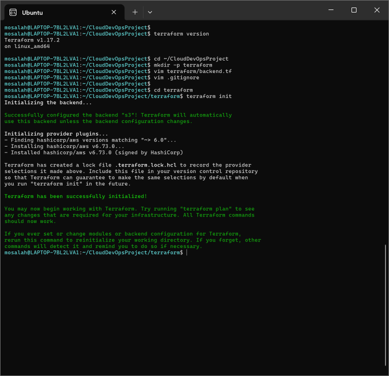

### 3. Network module

| Resource | Value |
|---|---|
| VPC | `10.0.0.0/16` with DNS support and hostnames |
| Public subnets | `10.0.1.0/24` (AZ a), `10.0.2.0/24` (AZ b) |
| Private subnets | `10.0.11.0/24` (AZ a), `10.0.12.0/24` (AZ b) |
| Internet Gateway | Default route of the public route table |
| NAT Gateway | One NAT in the first public subnet, default route of the private route table |

Subnets carry the tags EKS needs to place load balancers (`kubernetes.io/role/elb` on public, `kubernetes.io/role/internal-elb` on private).

Network ACLs (stateless, so return traffic on ephemeral ports must be allowed):

| NACL | Inbound | Outbound |
|---|---|---|
| Public | TCP 80, 443, 22, 8080 from anywhere, TCP 1024-65535 (return traffic), all traffic from the VPC | All |
| Private | All traffic from the VPC, TCP 1024-65535 (return traffic from the NAT) | All |

The NACLs are the coarse subnet-level layer. Fine-grained access is enforced by security groups (see the server module).

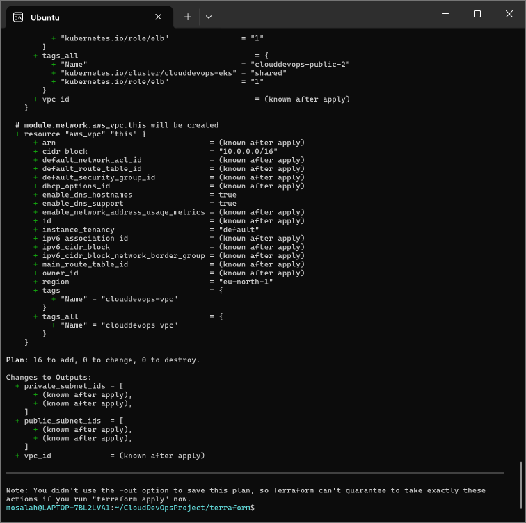
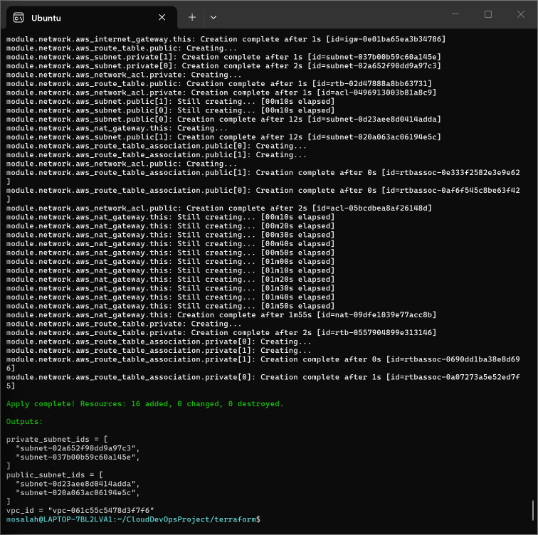
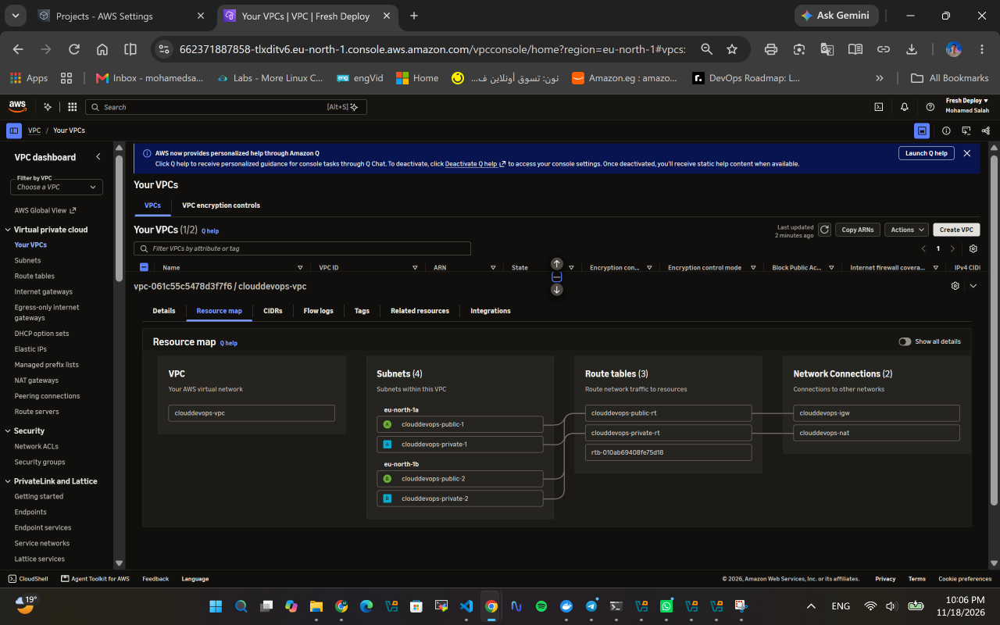


### 4. Server module (Jenkins EC2)

| Setting | Value |
|---|---|
| AMI | Latest Ubuntu 24.04 (Canonical), found with a `data` source |
| Instance type | `c7i-flex.large` (4 GB RAM, one of the types allowed on the AWS Free plan) |
| Subnet | First public subnet, with a public IP |
| Disk | 30 GB gp3 |
| Security group | SSH (22) and Jenkins UI (8080) only from `admin_cidr` (your IP), all outbound |
| Metadata | IMDSv2 required |
| Tags | `Name=clouddevops-jenkins`, `Role=jenkins` (used by the Ansible dynamic inventory) |

`admin_cidr` has no default. Pass your current public IP every time you apply, because it changes between sessions:

```bash
terraform apply -var="admin_cidr=$(curl -s https://checkip.amazonaws.com)/32"
```

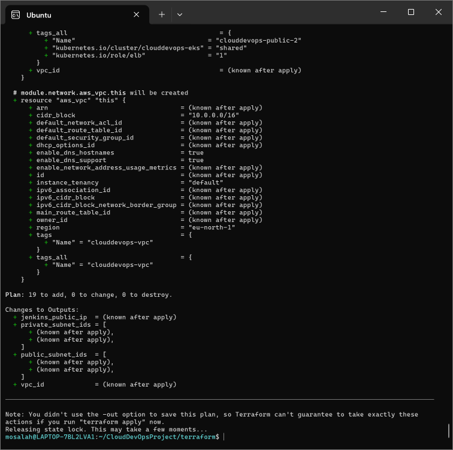
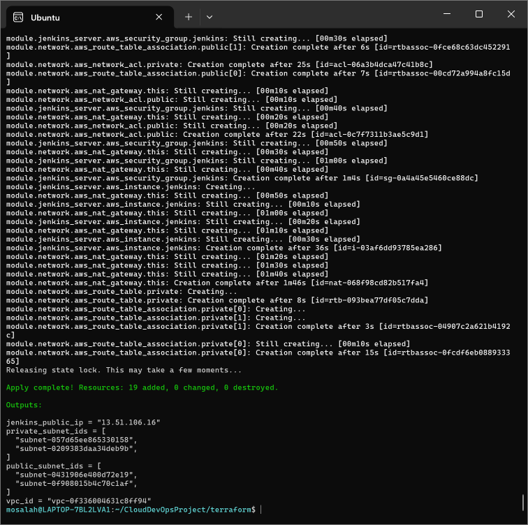
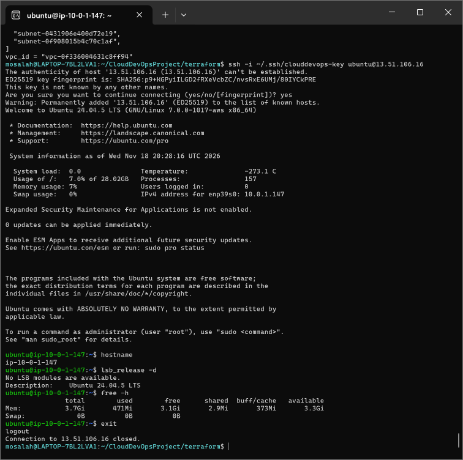
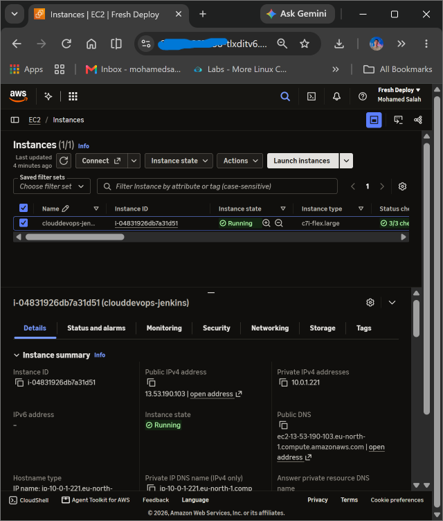
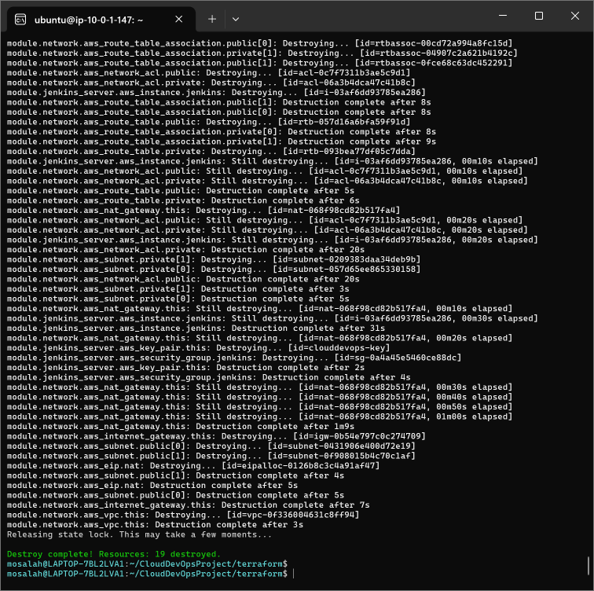

### 5. EKS and ECR modules

**EKS**

| Setting | Value |
|---|---|
| Cluster | Public and private API endpoint, creator gets admin through an EKS access entry |
| Subnets | Both public and private, so load balancers can use the public ones |
| Node group | 2 managed nodes (`c7i-flex.large`, Amazon Linux 2023, 20 GB), placed in the 2 private subnets, so each node is in a different AZ |
| Node IAM role | `AmazonEKSWorkerNodePolicy`, `AmazonEKS_CNI_Policy`, `AmazonEC2ContainerRegistryReadOnly` |
| Add-ons | `eks-pod-identity-agent` and `aws-ebs-csi-driver` (needed for the MySQL volume) |

**ECR**

Three private repositories: `ivolve-auth-service`, `ivolve-roadmap-service`, `ivolve-frontend`. Images are scanned on push, and `force_delete` lets `terraform destroy` remove repositories that still hold images.

```bash
aws eks update-kubeconfig --region eu-north-1 --name clouddevops-eks --kubeconfig ~/.kube/eks-config
export KUBECONFIG=~/.kube/eks-config
kubectl get nodes -o wide
kubectl get pods -n kube-system
```


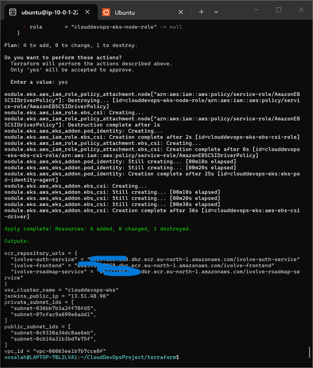
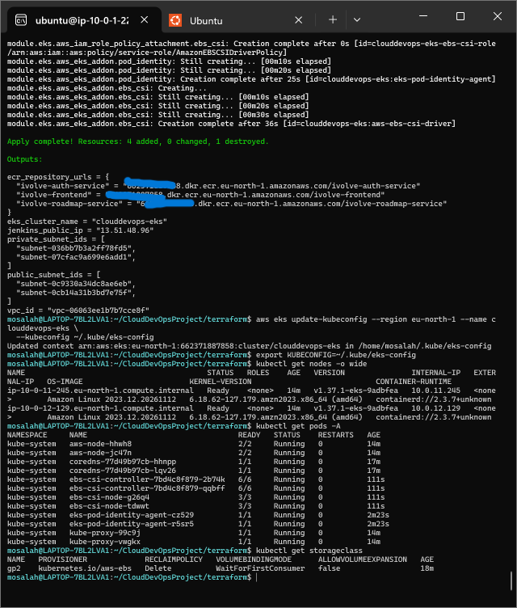


### Usage

```bash
cd terraform
terraform init
terraform plan  -var="admin_cidr=$(curl -s https://checkip.amazonaws.com)/32"
terraform apply -var="admin_cidr=$(curl -s https://checkip.amazonaws.com)/32"
terraform destroy -var="admin_cidr=$(curl -s https://checkip.amazonaws.com)/32"
```

| Variable | Default | Description |
|---|---|---|
| `admin_cidr` | none (required) | Your public IP in CIDR form, allowed to reach SSH and Jenkins |
| `project_name` | `clouddevops` | Prefix for resource names |
| `cluster_name` | `clouddevops-eks` | EKS cluster name |
| `vpc_cidr` | `10.0.0.0/16` | VPC range |
| `public_subnet_cidrs` | `10.0.1.0/24`, `10.0.2.0/24` | Public subnets |
| `private_subnet_cidrs` | `10.0.11.0/24`, `10.0.12.0/24` | Private subnets |
| `public_key_path` | `~/.ssh/clouddevops-key.pub` | SSH public key for the Jenkins server |
| `jenkins_instance_type` | `c7i-flex.large` | Jenkins server size |
| `eks_node_instance_type` | `c7i-flex.large` | EKS node size |

State files, `.terraform/` and `*.tfvars` are listed in `.gitignore`. The provider lock file (`.terraform.lock.hcl`) is committed.

### Design decisions

| Decision | Reason |
|---|---|
| One module per component, called from the root | Each part can be reused and changed on its own |
| S3 backend with versioning, encryption and native locking | Safe shared state without extra services |
| One NAT Gateway | Cheaper than one per AZ. It is a single point of failure, which is acceptable for a project environment |
| Worker nodes in private subnets only | Nodes are not reachable from the internet |
| Security group limited to the admin IP | Jenkins and SSH are not exposed to the whole internet |
| EKS Pod Identity for the EBS CSI driver | The driver gets its own IAM role instead of using the node role |
| No community modules | Every resource is written explicitly, which makes the design easy to explain |

### Troubleshooting

**EBS CSI controller in `CrashLoopBackOff`.** In the first version the EBS CSI policy was attached to the node IAM role. The `ebs-csi-controller` pods kept crashing and the add-on stayed in `CREATING`. Moving to EKS Pod Identity fixed it: the `eks-pod-identity-agent` add-on, a dedicated IAM role for `ebs-csi-controller-sa` and a `pod_identity_association` on the add-on. After the change, the controller pods are `6/6 Running`.

**SSH to the Jenkins server hangs.** The public IP of the workstation changed, so the security group no longer matched. Re-run `terraform apply` with the current IP (see Usage).

### Cost control

The NAT Gateway, the EKS control plane, the EKS nodes and the Jenkins instance are billed per hour. The environment is created for each working session and removed with `terraform destroy`. Everything is rebuilt from code, and the state stays in S3.

## Part 5: Container orchestration with Kubernetes

The application runs on Kubernetes in the `ivolve` namespace. It was first tested on a local kubeadm cluster (1 control plane + 2 workers) before moving to EKS.

### Manifests

| File | Purpose |
|---|---|
| `k8s/base/00-namespace.yaml` | `ivolve` namespace |
| `k8s/base/01-configmap.yaml` | Non-secret environment variables |
| `k8s/base/02-secret.yaml` | Passwords and session secret |
| `k8s/base/03-mysql-service.yaml` | Headless Service for the database |
| `k8s/base/04-mysql-statefulset.yaml` | MySQL StatefulSet with a PVC per pod |
| `k8s/base/05-auth-service.yaml` | Deployment (2 replicas) + Service |
| `k8s/base/06-roadmap-service.yaml` | Deployment (2 replicas) + Service |
| `k8s/base/07-frontend.yaml` | Deployment (2 replicas) + Service |
| `k8s/base/08-ingress.yaml` | Ingress for the frontend |
| `k8s/storage/vms-local-path.yaml` | StorageClass `ivolve-mysql-sc` for the local cluster |
| `k8s/ingress/traefik-values-vms.yaml` | Helm values for the Traefik ingress controller |

### Design decisions

| Decision | Reason |
|---|---|
| StatefulSet + headless Service for MySQL | Stable pod name (`mysql-0.mysql`) and its own volume |
| StorageClass `ivolve-mysql-sc` with `Retain` | Data is kept if the claim is deleted. The same name will be backed by EBS gp3 on EKS |
| Explicit env variables per service | Each service only receives the keys it needs |
| Readiness on `/health` (auth), `/api/roadmap` (roadmap), `/` (frontend) | Traffic only reaches ready pods |
| Liveness on TCP only | A database outage does not restart the auth pods |
| Resource requests and limits, no privilege escalation, all capabilities dropped | Safer and predictable scheduling |
| Traefik instead of ingress-nginx | The community ingress-nginx controller was retired in March 2026 |
| Sticky-session cookie (`ivolve_affinity`) on the frontend Service | The frontend keeps sessions in memory, so each user must stay on the same pod when running 2 replicas |
| Secret committed with lab-only values | Needed for GitOps. Production should use Sealed Secrets or External Secrets |

### Deploy on the local cluster

```bash
kubectl apply -f k8s/storage/vms-local-path.yaml
helm repo add traefik https://traefik.github.io/charts && helm repo update
helm upgrade --install traefik traefik/traefik -n traefik --create-namespace -f k8s/ingress/traefik-values-vms.yaml
kubectl apply -f k8s/base/
kubectl get pods,svc,ingress -n ivolve
```

The application is available on `http://<node-ip>:30080`.

### Evidence

Cluster nodes and Docker Hub images:

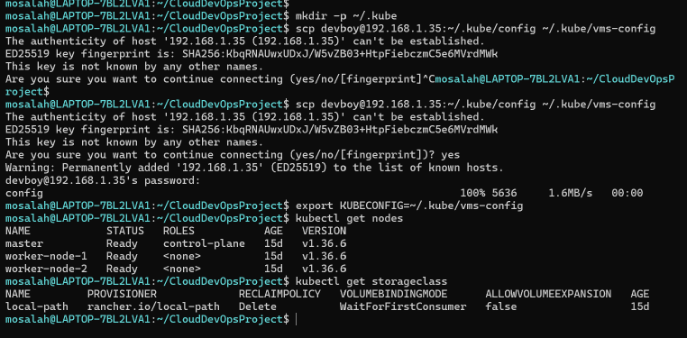
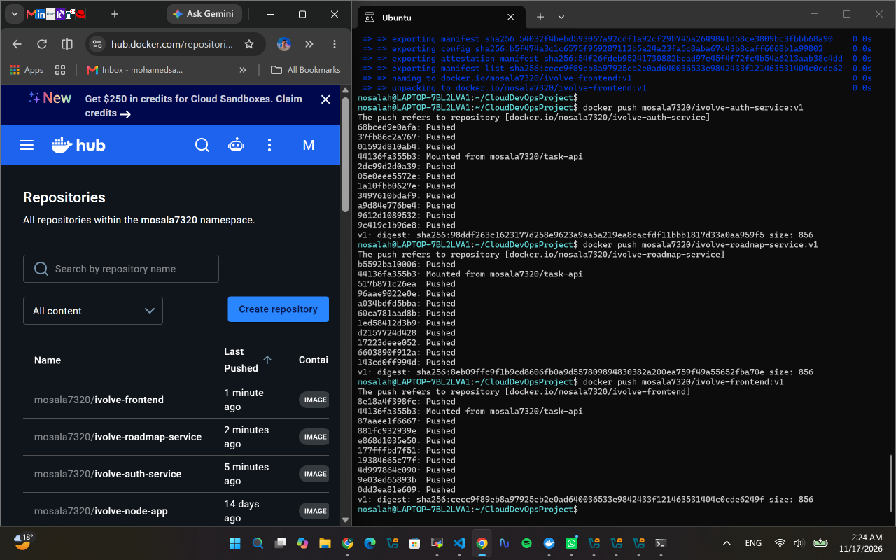

Namespace, ConfigMap and Secret:


MySQL StatefulSet, DNS and data persistence after deleting the pod:


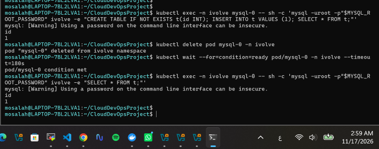

Deployments, Services and the running application:

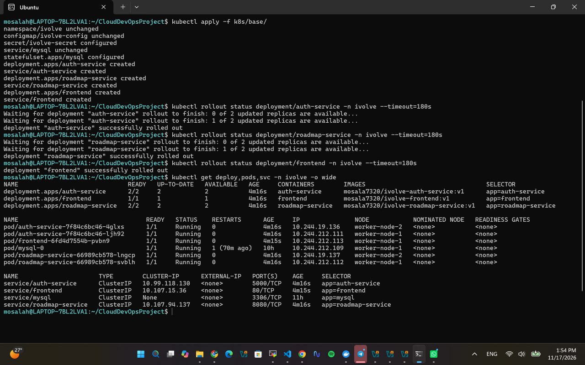
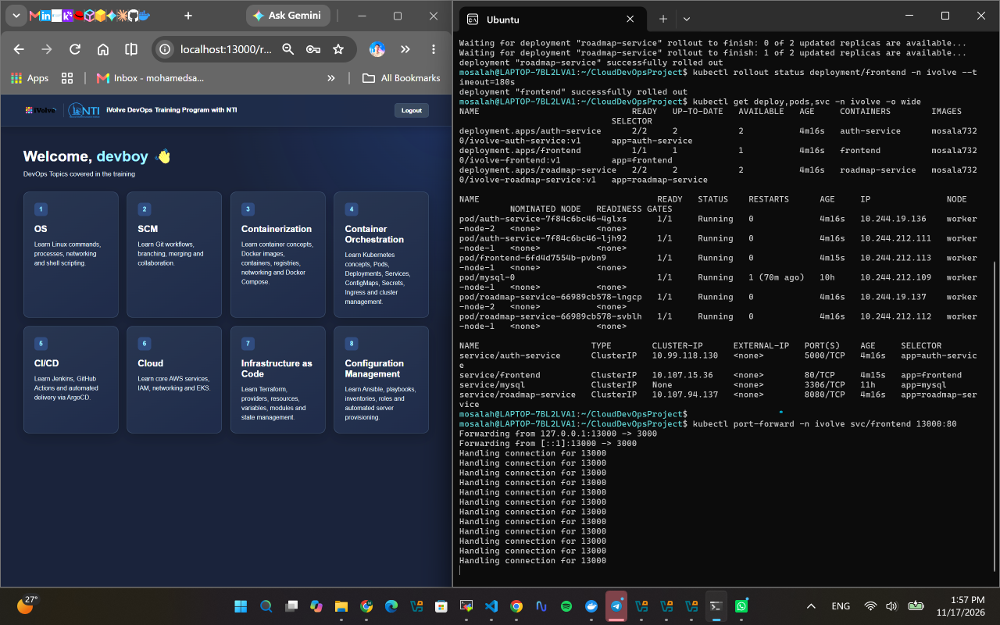

Ingress with Traefik, two frontend replicas and the sticky cookie:


