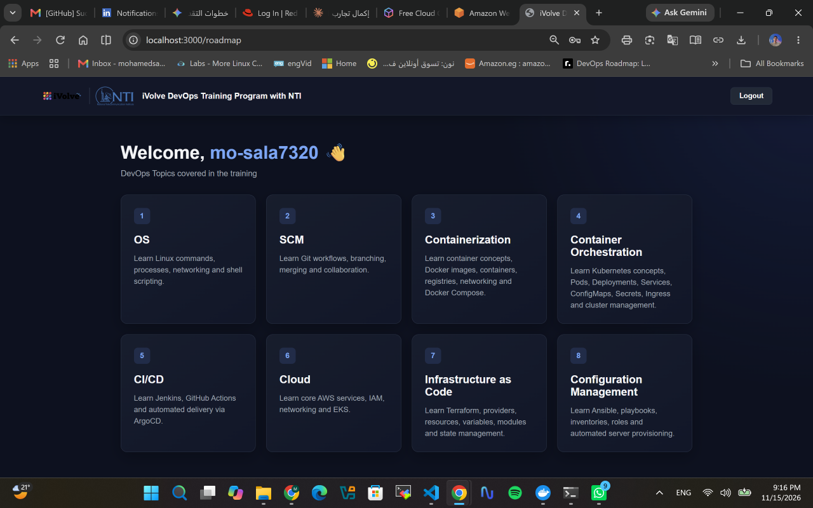
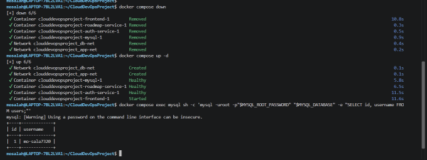

# CloudDevOpsProject

End-to-end DevOps project built as the final project of the NTI / iVolve DevOps training.
A microservices web application (registration, login and a DevOps roadmap page) is containerized with Docker, provisioned on AWS with Terraform, configured with Ansible, built by Jenkins and deployed to Kubernetes (EKS) with ArgoCD.

## Project status

- [x] 1. GitHub repository
- [x] 2. Containerization with Docker Compose
- [ ] 3. Infrastructure provisioning with Terraform
- [ ] 4. Configuration management with Ansible
- [ ] 5. Container orchestration with Kubernetes
- [ ] 6. Continuous integration with Jenkins
- [ ] 7. Continuous deployment with ArgoCD
- [ ] 8. Documentation

## Application architecture

```text
Browser
   |
   v
Frontend (Node.js, :3000)
   |-----------------------> Auth Service (Python/Flask, :5000) ---> MySQL (:3306)
   |
   '-----------------------> Roadmap Service (Java, :8080)
```

The frontend is the only entry point. Only the Auth Service talks to the database.

| Service | Technology | Port | Responsibility |
|---|---|---|---|
| frontend | Node.js 22, Express, EJS | 3000 | Web UI, user session, calls the backend services |
| auth-service | Python 3.12, Flask, gunicorn, bcrypt | 5000 | Signup and login, stores users in MySQL |
| roadmap-service | Java 21, Maven, Spring Boot | 8080 | Serves the DevOps roadmap data |
| mysql | MySQL 8.4 | 3306 | `users` table (created automatically by the auth service) |

> **Note:** the upstream application README lists the Auth Service as Java and the Roadmap Service as Python.
> The source code shows the opposite, so this documentation follows the code.

### Endpoints used by the frontend

| Service | Method | Path |
|---|---|---|
| auth-service | POST | `/api/auth/signup` |
| auth-service | POST | `/api/auth/login` |
| auth-service | GET | `/health` |
| roadmap-service | GET | `/api/roadmap` |

### Environment variables

| Service | Variable | Description |
|---|---|---|
| auth-service | `DB_HOST`, `DB_PORT`, `DB_NAME`, `DB_USER`, `DB_PASSWORD` | MySQL connection (all required except `DB_PORT`, default 3306) |
| frontend | `AUTH_SERVICE_URL` | URL of the Auth Service |
| frontend | `ROADMAP_SERVICE_URL` | URL of the Roadmap Service |
| frontend | `SESSION_SECRET` | Secret used to sign the session cookie |

## Repository structure

```text
.
├── auth-service/          # Flask app + Dockerfile
├── frontend/              # Express app + Dockerfile
├── roadmap-service/       # Java app + Dockerfile
├── docs/screenshots/      # Screenshots used in this README
├── docker-compose.yml
├── .env.example
└── README.md
```

## Part 2: Containerization with Docker Compose

### Run locally

```bash
git clone https://github.com/mohamedsala7320-sudo/CloudDevOpsProject.git
cd CloudDevOpsProject
cp .env.example .env      # then set your own values in .env
docker compose up --build -d
docker compose ps
```

Open http://localhost:3000, create an account and log in.

The `.env` file is ignored by Git. Only `.env.example` is committed.




### Verify the data in MySQL

Passwords are stored as bcrypt hashes, never as plain text.

```bash
docker compose exec mysql sh -c 'mysql -uroot -p"$MYSQL_ROOT_PASSWORD" "$MYSQL_DATABASE" -e "SELECT id, username, password_hash FROM users;"'
```


### Data persistence

User data lives in the `mysql-data` volume and survives `docker compose down`.



### Design decisions

| Decision | Reason |
|---|---|
| gunicorn instead of the Flask development server | The development server is not meant for production |
| Non-root user in every image | Limits the impact of a container compromise |
| Multi-stage build for the Java service | The final image has only a JRE and the jar, so it is smaller and has fewer vulnerabilities |
| `.dockerignore` for each service | Faster builds and no local files copied into images |
| Two networks (`app-net`, `db-net`) | The frontend cannot reach the database directly |
| Healthchecks with `depends_on: service_healthy` | Services start in the right order |
| Secrets in `.env` with `:?` checks | Compose stops early with a clear message if a variable is missing |
